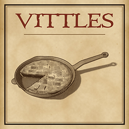

# Vittles (beta)

**Download:** see the [latest release](https://github.com/Dixiecapt/Vittles/releases/latest): `Vittles-1.0.64.zip` to put in by hand (the `Vittles` folder goes into `BepInEx\plugins`), `Vittles-1.0.64-thunderstore.zip` for r2modman / Thunderstore, and `Vittling_Book.pdf`, the illustrated manual. **Vittles needs [Better Stoves 1.0.20](https://github.com/Dixiecapt/Better-Stoves/releases/latest).**

**Made by Dixiecapt with M.I.D.N**

> **M.I.D.N shares the credit for this mod.** He ran five full playtests through November 2026. His careful, heavy-duty testing found the faults, shaped the rules and made Vittles what it is. Thank you, M.I.D.N.

Vittles turns your ship's galley into a working kitchen. Fry, grill, stew, bake, mill, pickle and salt down meat, and every dish you make feeds you better than raw food.

This is the **early beta, Vittles 1.0.64**. It needs **Better Stoves 1.0.20** (installed for you by the mod manager).

**The Vittling Book** (`Vittling_Book.pdf`, 52 pages, in this package) is the full manual: every recipe, step by step, with engraved plates. You also carry a shorter **Victualling Book** in game.

## What Vittles adds

| Kind | What you get |
|---|---|
| Pans and bowls | A cast-iron skillet, a wok, a baking sheet, and wooden, metal and porcelain bowls |
| Cooking | Stir-fry, grilling in a pan, cold mixes, soups made with drink, porridge, rice, bread, pies and puddings |
| Named dishes | Pease soup, lobscouse, ship's chowder, bubble and squeak, sea pie, plum duff, figgy dowdy and more, each with a bonus |
| New foods | Cabbage, dried peas, limes, sea biscuit, beef, eggs, rice, spices and coconuts |
| Mills | Grain mills in ten towns that grind oatmeal, flour, rice and spices |
| Baking | Bread, pies and puddings in the ovens of Better Stoves' Brick Galley and Camboose, and on the Brodie's gridiron |
| Keeping food | Preserving jars, sauerkraut, casks of salt pork and salt beef, crates you nail shut |
| Livestock | A chicken coop with three hens that lay eggs |
| Grog | The navy's drink, mixed in a mug, bottle, bucket, barrel or pot |
| The Victualling Book | An in-game book with your provisions aboard, the cooking guide and your own cook's log |

The game's own food scroll (the *Nutrition & Food Preservation Guide for Sailors*) is rewritten with Vittles' rules.

## Why Better Stoves is needed

Vittles cooks on Better Stoves' stoves and bakes in their ovens. The Brick Galley and the Camboose bake behind their oven doors, the Brodie Galley Range bakes on its open gridiron, and their copper boilers make big soups. Vittles will not start without **Better Stoves 1.0.20 or newer**.

## Installing

**With a mod manager (Thunderstore Mod Manager or r2modman):** find **Vittles** and install it. The manager brings Better Stoves and BepInExPack with it. Start the game from the manager.

**By hand:**

1. Install BepInEx 5 for Sailwind, if you have not already, and run the game once.
2. In your Sailwind folder, open `BepInEx\plugins`.
3. Make a folder named `Vittles` and put `Vittles.dll` and the `vittles` bundle file in it, side by side.
4. Install Better Stoves 1.0.20 the same way (its own folder, `BetterStoves`, with its DLL and four bundle files).
5. Start the game. Press **F1**: you should see a **Vittles** section and a **Better Stoves** section.

Keep each bundle file next to its own DLL. Without it the items cannot be made.

## Your first meal

1. Buy a skillet (beside the pots in any shop that sells pots; the wok in Emerald) and a bowl (beside the mugs).
2. Cut pork and potato on a table with a knife, and put the slices in the skillet.
3. Set the skillet on a lit stove. Look at the pan to see how far done it is.
4. When it is done, hold the bowl and click the pan. Eat with the use key.

Hold **Left Alt** and press use on a pan, pot, bowl, jar or coop to open the Victualling Book at that thing's page.

## Good to know

- **A save that holds any Vittles item will not load without Vittles.** Before removing the mod, sell, eat or drop every Vittles item (pans, bowls, sacks, jars, casks, the coop, the new foods) and save. The same goes for Better Stoves and its stoves.
- Vittles draws all bread, baguettes and buns at 39% of their old size so they fit a pan, and lays out the kitchenware tables at Fort Aestrin, Dragon Cliffs and Gold Rock afresh.
- **Works with:** Sailwind Farming (same new foods and grog), Cooked Info (its settings rule the pans' readout), Hooks Hang More (pans and boilers hang on its hooks).
- Every number you might want to change is in **F1**, under Vittles.

## Found a bug?

This is a beta, so please tell me. Post in the **Vittles post on the Sailwind modding Discord**, or **message Dixiecapt on Discord**.

Please send your **log file** with it: `BepInEx\LogOutput.log`. In a mod manager it is under Settings, *Browse profile folder*, then `BepInEx`. Say what you did just before it went wrong; a picture helps. I will look into every report.

## Credits

- **Dixiecapt**: the mod, its code, the Brick Galley, Camboose and pie models.
- **M.I.D.N**: shared credit. Five full playtests that shaped Vittles.
- **Tiberiu**: the hen (CGTrader, CC BY 4.0).
- **ayhancerci**: the "Old flour mill" (Sketchfab, CC BY 4.0).
- The Vittling Book is set in **Immortal** (Graham Meade & Apostrophic Labs), the face Sailwind uses, with **IM Fell English** by Igino Marini (SIL Open Font License 1.1).

Cooking, fire, smoke and sound come from the game's own stoves and pots. Sailwind is the work of Raw Lion Workshop. Vittles is an unofficial modification and is not affiliated with them.

## Licence

The code is under the **MIT licence**, Copyright (c) 2026 Dixiecapt (see `LICENSE`). Models by others keep their own licences (see `THIRD_PARTY.md`).
